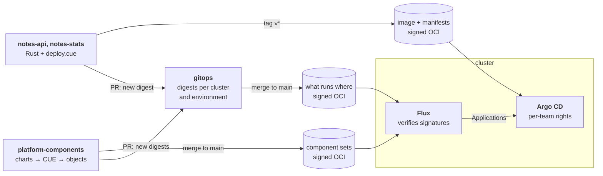
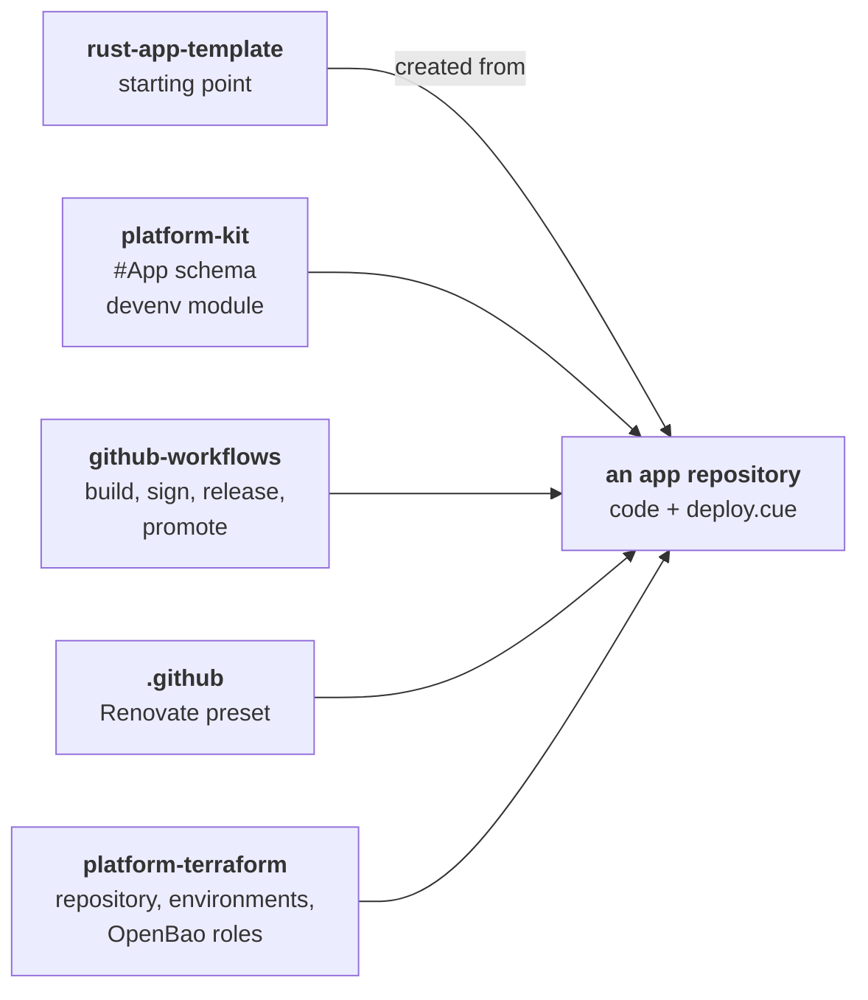

# homelab-selfuryon

A worked example of how a small company's **platform team** runs Kubernetes with **CUE** and secure
defaults, and how product teams (Rust only) ship onto it without an internal developer portal and
without Helm charts of their own.

- **Delivery flow and the contracts between repositories:** [delivery.md](delivery.md)
- **Decisions and open questions:** [decisions.md](decisions.md)
- **Security baseline:** [security-baseline.md](security-baseline.md)
- **The GitHub org itself:** [org.md](org.md)

## How a change reaches the cluster

Source repositories publish signed OCI artifacts and open a PR in `gitops` that moves a digest.
`gitops` publishes what runs where; the cluster only pulls.

Staging PRs merge automatically after checks; prod PRs are opened by hand and approved by the team.
The details are in [delivery.md](delivery.md).

## What the platform gives a product team

A team writes code and one `deploy.cue`. Everything else comes as versioned dependencies, bumped by
Renovate:

## Repositories

| Repo | Owner | What it is |
| --- | --- | --- |
| [`meta`](README.md) | platform | This documentation. |
| [`.github`](dot-github.md) | platform | Org profile, default community health files, shared Renovate preset. |
| [`platform-terraform`](platform-terraform.md) | platform | OpenTofu per provider: `github/` (org, repositories, rulesets, teams), `openbao/` (auth, policies, roles). Local state, applied by the owner. |
| [`github-workflows`](github-workflows.md) | platform | Reusable workflows: build, sign, render, publish, PR to `gitops`, promote, `gitops` checks. Their identity is the release trust anchor. |
| [`platform-kit`](platform-kit.md) | platform | The paved road: CUE module with `#App` and environment definitions, devenv module for Rust apps. |
| [`platform-components`](platform-components.md) | platform | Cluster definitions (Talos), platform components, Kyverno policies, team onboarding. Releases one signed artifact per component set and cluster. |
| [`gitops`](gitops.md) | platform; teams own their version files | What runs where: digests per cluster set and per app environment. Rendered to Flux and Argo CD objects, published as a signed OCI artifact. |
| [`rust-app-template`](rust-app-template.md) | platform | GitHub template for a new app. |
| [`notes-api`](notes-api.md) | notes | Example app: REST API with Postgres. |
| [`notes-stats`](notes-stats.md) | notes | Example app: calls `notes-api` with a projected ServiceAccount token. |

## Stack

Talos · Cilium (network policy, host firewall, Hubble) · Flux Operator · Argo CD · Kyverno (CEL
policies) · Envoy Gateway (Gateway API) · cert-manager · external-dns · CloudNativePG · OpenBao +
Secrets Store CSI driver · CUE · devenv · cosign · Renovate · OpenTofu · octo-sts.
