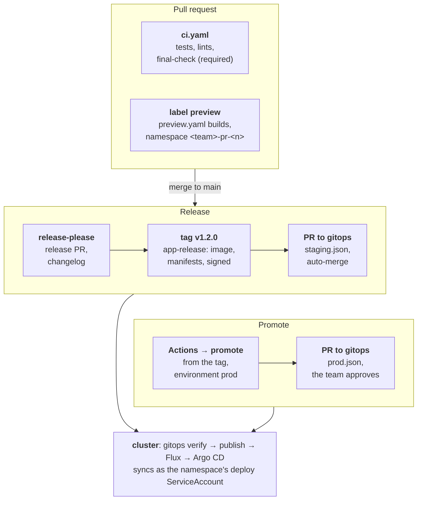

# App release lifecycle

What a product team does, and what happens on its behalf, from a new app to a change in prod. The
team writes Rust and one `deploy.cue`; everything else is the platform's paved road. Exact names and
contracts: [delivery.md](delivery.md); the architecture behind it:
[gitops-architecture.md](gitops-architecture.md).

## The lifecycle at a glance

## 1. A new app

Members cannot create repositories. A PR to [`catalog`](catalog.md) adds the
app to `teams/<team>.cue`; its `catalog.json` goes to `platform-terraform`, `platform-components`
and `gitops`. The owner's `tofu apply` creates the repository from `rust-app-template` with its
custom properties (`owner-team`, `kind=app`), team access, the `staging`/`prod` environments (tags
`v*` only), the rulesets and the label `preview`, and in OpenBao the app's roles per environment;
the `gitops` PR adds the `{}` version files, and its checks compare the team with the repository's
`owner-team`. The team's first PR renames the template. Details:
[delivery.md](delivery.md#flow-a-new-app-onboarding).

A new team is a new `teams/<team>.cue` in `catalog`: the GitHub team, and in `platform-components`
its namespaces, quotas, AppProjects and deploy ServiceAccounts.

## 2. Pull requests

- `ci.yaml` runs on every PR: `devenv test` (format, clippy, tests, cargo-deny, the
  Containerfile/toolchain version check), `cue vet` of `deploy.cue`, workflow lint. `final-check`
  is the one required check; merges go through it (auto-merge is on).
- **Preview environments are opt-in:** the label `preview` starts `preview.yaml` (its own workflow,
  so label events never re-run or cancel the checks). It builds image `pr-<n>-<sha7>` and manifests
  `pr-<n>`, signed with the _preview_ identity, which staging and prod never accept. The Argo CD
  ApplicationSet picks up labelled PRs every few minutes and creates `<team>-pr-<n>` (Pod Security
  restricted, default-deny, a quota, `view` for the team, host
  `<app>-pr-<n>.preview.<domain>`). Removing the label or closing the PR removes the Application;
  the empty namespace is deleted within the hour (Kyverno `cleanup-preview-namespaces`).

## 3. Release to staging

Merging to `main` updates a release PR (release-please, version from Conventional Commits). Merging
that PR tags `v<version>`, and `release.yaml` calls `app-release` in the `staging` environment:

- image from the Containerfile (distroless runtime, base images by digest), SBOM and provenance,
  cosign keyless signature;
- `deploy.cue` rendered for staging and prod into one manifests artifact, signed the same way;
- an octo-sts token for `gitops` that only this workflow in this environment can get, and a PR that
  moves `apps/<team>/<app>/staging.json` to the new digest, with auto-merge.

`gitops verify` then checks the artifact's signature: issuer, the `app-release.yaml` identity, the
source repository and tag, and that the workflow commit is on `github-workflows` main. After the
merge `gitops` publishes, Flux applies the Application, and Argo CD syncs it into
`<team>-staging`, impersonating that namespace's `deployer` ServiceAccount. Kyverno admits the pods
only with images signed by `app-release.yaml` and pinned by digest.

## 4. Promote to prod

Actions → **promote** → "Use workflow from: `v1.2.0`" (environment `prod`). `app-promote` resolves
the same manifests digest, verifies it, and opens the PR for `prod.json`. CODEOWNERS name the team
as the owner of its own `prod.json`, so with required code-owner review (the default of
`platform-terraform`) the platform cannot ship a team's prod alone and a team cannot touch another
team's. This homelab has one maintainer and runs without required review
([org.md](org.md#solo-maintainer-exception)). From the merge on, the path is the same as staging.

## 5. Rollback

Revert the PR in `gitops` (staging or prod). The old digest is still signed and in GHCR.

## What the team sees and controls

| The team can                                                  | How                                                                    |
| ------------------------------------------------------------- | ---------------------------------------------------------------------- |
| read its namespaces (`view`, no Secrets), previews included   | RoleBinding `team-view` for the GitHub team's group                    |
| read its Argo CD Applications and their events, nobody else's | namespace `argocd-<team>` (staging, prod); Argo CD has no UI           |
| choose replicas, ports, hosts, calls, database, secrets       | `deploy.cue` (`#App` from `platform-kit`); admission has the last word |
| put secrets                                                   | the owner writes them to OpenBao; the app reads files                  |
| approve its prod                                              | CODEOWNERS on `apps/<team>/*/prod.json` (with required review)         |

It cannot exec into pods, port-forward, create cluster-scoped objects, run unsigned or
unpinned images, reach other teams' pods unless both sides declare it, or change its AppProject.
Why each fence exists: [gitops-architecture.md](gitops-architecture.md).

## Keeping an app current

| What                                | How                                                                                                                                       |
| ----------------------------------- | ----------------------------------------------------------------------------------------------------------------------------------------- |
| Crates, actions, base image digests | Renovate, auto-merged when CI passes (majors and 0.x minors wait for a person)                                                            |
| `platform-kit`, reusable workflows  | Renovate PRs; a `platform-kit` bump is `fix(deps)` and releases; workflows pinned by SHA                                                  |
| `devenv.lock` (toolchains, tools)   | weekly `devenv update` PR (Monday 06:00 UTC), auto-merged when CI passes                                                                  |
| Rust                                | `rust-toolchain.toml` and the Containerfile build image in one Renovate PR, Mondays after 09:00 UTC, once the version is in `devenv.lock` |
