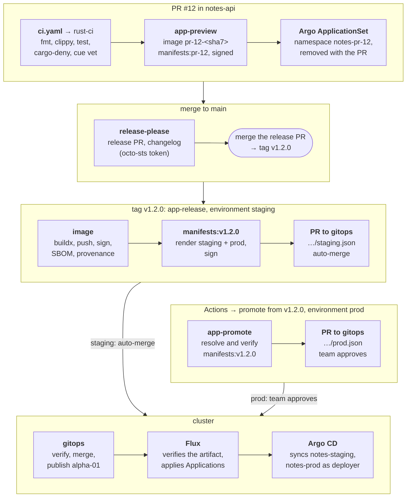
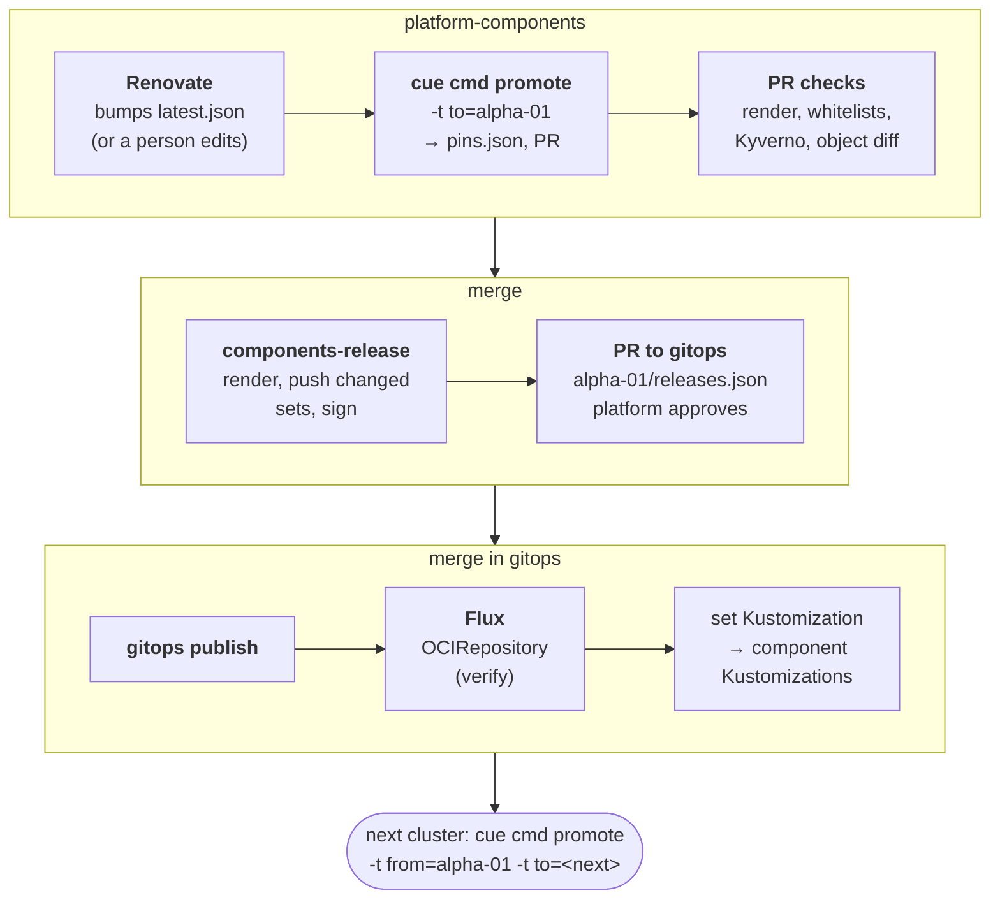
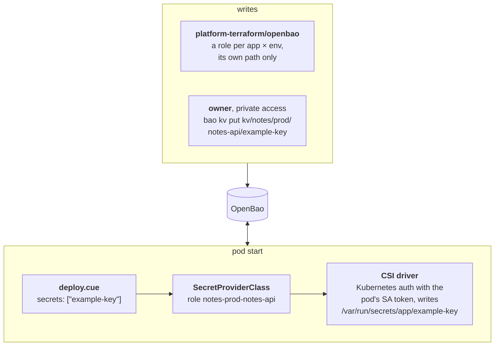
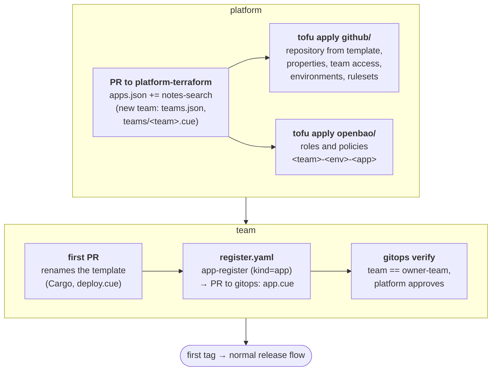

operator in `cnpg-system`; `Cluster` `<app>-db`, Secret `<app>-db-app`; image from `spec.imageCatalogRef` → `ClusterImageCatalog` `postgresql` (major 18), no `imageName`, no superuser (enforced)# Delivery: flows and contracts

How code becomes running objects, and the exact interfaces between repositories. The why behind
each choice is in [decisions.md](decisions.md). When a repository and this page disagree, fix one of
them in the same change — this page is the contract the repositories are built against.

## Names

| Thing                     | Value                                                                                                                                    |
| ------------------------- | ---------------------------------------------------------------------------------------------------------------------------------------- |
| GitHub org                | `homelab-selfuryon`                                                                                                                      |
| Registry                  | `ghcr.io/homelab-selfuryon`                                                                                                              |
| CUE registry              | `CUE_REGISTRY='inline:moduleRegistries: "github.com/homelab-selfuryon": {registry: "ghcr.io/homelab-selfuryon/cue", stripPrefix: true}'` |
| Label / annotation prefix | `homelab-selfuryon.github.io/` (`team`, `env`, `managed-by`, `component`)                                                                |
| Cluster                   | `alpha-01` (Talos, one node). Design allows more.                                                                                        |
| Domain                    | `homelab.example` — placeholder until a real domain is chosen                                                                            |
| Teams                     | `platform`, `notes` (GitHub teams of the same name)                                                                                      |
| Environments              | `preview`, `staging`, `prod`                                                                                                             |
| Tenant namespaces         | `<team>-staging`, `<team>-prod`, `<team>-pr-<n>` (preview)                                                                               |
| Hostnames                 | prod `<app>.<domain>`, staging `<app>.staging.<domain>`, preview `<app>-pr-<n>.preview.<domain>`                                         |
| Platform namespaces       | `<component>-system` (`flux-system`, `cilium` is the exception: `kube-system`)                                                           |

## Artifacts

All OCI artifacts are pushed with `oras`, one layer of media type
`application/vnd.oci.image.layer.v1.tar+gzip` (readable by Flux `OCIRepository` with a
`layerSelector` and by Argo CD OCI sources), signed with cosign keyless (issuer
`https://token.actions.githubusercontent.com`). Clusters always reference them by digest.

| Artifact                              | Tag                                  | Content                                                                                                                   | Signed by workflow                                                           | Source repo in the certificate |
| ------------------------------------- | ------------------------------------ | ------------------------------------------------------------------------------------------------------------------------- | ---------------------------------------------------------------------------- | ------------------------------ |
| `<app>` (image)                       | `<version>`, preview `pr-<n>-<sha7>` | distroless image (Containerfile), SBOM + provenance attestations                                                          | `app-release.yaml` / `app-preview.yaml`                                      | the app                        |
| `<app>/manifests`                     | `<version>`                          | `staging/manifests.yaml`, `prod/manifests.yaml`                                                                           | `app-release.yaml`                                                           | the app                        |
| `<app>/manifests`                     | `pr-<n>`                             | `preview/manifests.yaml`                                                                                                  | `app-preview.yaml`                                                           | the app                        |
| `platform-components/<cluster>-<set>` | content hash                         | `kustomizations.yaml` + `<component>/manifests.yaml`                                                                      | `platform-components/.github/workflows/release.yaml` (own job, not reusable) | `platform-components`          |
| `gitops/<cluster>`                    | `main` + git SHA                     | `flux/` (set OCIRepositories + Kustomizations, `argo-apps`), `argo/` (Applications, ApplicationSets)                      | `gitops/.github/workflows/publish.yaml` (own job, not reusable)              | `gitops`                       |
| `platform-kit` (CUE module)           | `v<semver>` (git tag)                | `cue mod publish` of module `github.com/homelab-selfuryon/platform-kit@v0` → `ghcr.io/homelab-selfuryon/cue/platform-kit` | `platform-kit` own `release.yaml` (`GITHUB_TOKEN`, `packages: write`)        | —                              |

CUE modules have their own prefix: `CUE_REGISTRY` (an inline config with `stripPrefix`) maps the module path
`github.com/homelab-selfuryon/<repo>` to `ghcr.io/homelab-selfuryon/cue/<repo>`, so any repository can
publish a module next to its image and manifests without a name collision. The platform-kit devenv
module sets `CUE_REGISTRY` for every shell. Modules are public packages, consumers need no `cue login`.

Certificate identities:

- **App artifacts** (checked by gitops verify and Kyverno):
  `^https://github\.com/homelab-selfuryon/github-workflows/\.github/workflows/<workflow>\.yaml@.+$`
  plus the source repository (`--certificate-github-workflow-repository`) and, for releases, the
  source ref (`--certificate-github-workflow-ref` = `refs/tags/v*`). Any workflow ref, because callers pin
  `github-workflows` by commit; gitops verify also requires the commit the workflow ran from
  (Build Signer Digest, OID 1.3.6.1.4.1.57264.1.10) to be on `github-workflows` main, since a fork's
  commit is reachable by SHA through the parent repository. Preview artifacts carry a
  different workflow identity, so nothing that checks for `app-release.yaml` admits them.
- **Artifacts Flux verifies** (`gitops/<cluster>`, platform sets) are signed in a job defined in the
  publishing repository itself, not in a reusable workflow, so the certificate subject carries that
  repository and its ref:
  `^https://github\.com/homelab-selfuryon/gitops/\.github/workflows/publish\.yaml@refs/heads/main$`
  (`platform-components/.../release.yaml@refs/heads/main` for sets). Flux matches only issuer and
  subject; with a reusable workflow the subject would name `github-workflows`, and a workflow on any
  branch of `gitops` could produce an artifact Flux accepts. Pinning `@refs/heads/main` closes that:
  only reviewed `main` can publish.

All GHCR packages are **public** (Argo CD and Flux pull without credentials).

## Bot tokens (octo-sts)

| Thing                        | Value                                                                                                                                                                                                                                                                                                                            |
| ---------------------------- | -------------------------------------------------------------------------------------------------------------------------------------------------------------------------------------------------------------------------------------------------------------------------------------------------------------------------------- |
| Instance                     | the public octo-sts instance (Chainguard), endpoint `octo-sts.dev` (the `octo-sts/action` default)                                                                                                                                                                                                                               |
| GitHub App                   | the public `octo-sts` App, installed on the org (selected repositories: `gitops` and the repositories whose workflows open PRs or push tags in themselves)                                                                                                                                                                       |
| Bot login in PRs and commits | `octo-sts[bot]`; commits are created through the API and signed by GitHub                                                                                                                                                                                                                                                        |
| Trust policies               | `.github/chainguard/<identity>.sts.yaml` in the target repository                                                                                                                                                                                                                                                                |
| OIDC subject format          | this org gets GitHub's immutable, ID-based subjects: `repo:homelab-selfuryon@353728095/<repo>@<repo_id>:ref:refs/heads/main` (or `:environment:<env>`). Policies use `subject_pattern` with the org ID pinned; a repository's own policies also pin its name, cross-repository ones in `gitops` accept any repository of the org |

Rendered manifests carry no `metadata.namespace` for namespaced objects; the namespace comes from the
delivery object (Argo `destination.namespace`, Flux `targetNamespace`).

## App contract (`deploy.cue`)

An app repository has `cue.mod/` at the root (module `github.com/homelab-selfuryon/<app>@v0`,
depending on `github.com/homelab-selfuryon/platform-kit@v0`) and `deploy/deploy.cue`:

```cue
package deploy

import "github.com/homelab-selfuryon/platform-kit/app"

app.#App & {
	name:   "notes-api"
	team:   "notes"
	port:   8080
	size:   "small"          // small | medium | large → resources, replicas per env
	public: true             // HTTPRoute on the environment's Gateway
	database: postgres: {}   // CloudNativePG cluster, credentials as files
	secrets: ["example-key"] // OpenBao kv/<team>/<env>/<name>/, files in /var/run/secrets/app/
	env: LOG_LEVEL: "info"   // non-secret config only
	network: {
		allowFrom: [{app: "notes-stats"}]
		calls: []            // [{app: "notes-api"}] → egress + projected token with that audience
		egressFQDN: []
		kubeAPI: true        // egress to kube-apiserver (JWKS for caller tokens)
	}
}
```

Render interface (used by the reusable workflows, also runnable locally):

- CI writes `deploy/context_gen.cue` (git-ignored): `package deploy` +
  `context: {env: "staging", image: "ghcr.io/…/<app>@sha256:…", version: "v1.2.0", pr?: 12}`.
- `cue export ./deploy -e manifestsYAML --out text` prints a multi-document YAML stream for that
  environment.

What `#App` renders: ServiceAccount (no token automount), Deployment (PSA restricted, non-root
65532, read-only rootfs, drop ALL, seccomp `RuntimeDefault`, image by digest, `/healthz` and `/readyz`
probes), Service, PodDisruptionBudget (prod), HTTPRoute (if `public`), CiliumNetworkPolicy (ingress
from `allowFrom` and the Gateway, egress to DNS, `calls`, `egressFQDN`, the database, kube-apiserver
if `kubeAPI`), CloudNativePG `Cluster` (if `database`), SecretProviderClass for OpenBao (if
`secrets`). Mount points: `/var/run/secrets/app/<key>`, `/var/run/secrets/db/` (CNPG `-app`
Secret: `uri`, `username`, `password`, …), `/var/run/secrets/tokens/<app>/token` (projected,
audience `<app>`), `/var/run/secrets/kube-api/{token,ca.crt}` (if `kubeAPI`: projected token
with the API server audience + cluster CA, to fetch the JWKS).

Environment the render injects (a team's `env` may not use these names): `PORT`, `APP_ENV`,
`APP_VERSION`; with `allowFrom`: `AUTH_AUDIENCE` (= app name) and `AUTH_ALLOWED_SUBJECTS`
(`system:serviceaccount:<ns>:<caller>` per entry); per `calls` entry `<CALLEE>_URL`. In preview,
`calls` go to the staging namespace and are refused there (preview identities are not allowlisted).

The CUE language version is v0.17 (the release in nixpkgs). CRD schemas (Cilium, Gateway API,
CloudNativePG, Secrets Store CSI) are closed definitions in `platform-kit/crd/`; the central
registry has none.

## gitops layout

```
cue.mod/                           module github.com/homelab-selfuryon/gitops@v0
schema/                            #Cluster, #App registration, #Version, render → Flux/Argo objects
clusters/<cluster>/cluster.cue     the cluster: name, artifact identities
clusters/<cluster>/releases.json   {"<set>": {"version": "…", "digest": "sha256:…"}}   ← platform-components PRs
apps/<team>/<app>/app.cue      registration: team, repo, cluster, preview on/off   ← platform-owned
apps/<team>/<app>/staging.json     {"version": "v1.2.0", "digest": "sha256:…"}          ← release PR, auto-merged
apps/<team>/<app>/prod.json        same shape                                          ← promote PR, team approves
.github/CODEOWNERS                 * → platform; apps/*/*/staging.json → nobody; apps/<team>/*/prod.json → <team>
.github/chainguard/*.sts.yaml      octo-sts trust policies
```

`cue cmd render` produces per cluster: for every set in `releases.json` an `OCIRepository`
(digest, cosign verify) and a `Kustomization` that applies the set's `kustomizations.yaml`; for every
app and environment an Argo CD `Application` (project `<team>`, source
`oci://ghcr.io/homelab-selfuryon/<app>/manifests` at the digest, path `<env>`, destination
`<team>-<env>`, automated sync with prune and self-heal); for every app with preview an
`ApplicationSet` (pull request generator → project `<team>-preview`, revision `pr-<n>`, namespace
`<team>-pr-<n>`, created by Argo).

PR checks (`gitops/.github/workflows/verify.yaml`, "gitops verify" below): CUE vet and render; for every changed version file the artifact's
signature, workflow identity and source repository (the registration's repo), and that the tag
`version` resolves to `digest`; a release PR from an app touches only that app's version
files; Kyverno CLI over the referenced manifests with the policy set the cluster currently runs;
object diff old → new as a PR comment.

## Platform layout (`platform-components`)

Components are CUE packages; a chart component is rendered with `helm template` in CI (variant B),
or listed as a `HelmRelease` exception (variant A: on alpha-01 Kyverno; the `HelmRelease` and its
source are in `flux-system`, the component's Kustomization has no `targetNamespace`). Each cluster
resolves component versions from `registry/latest.json` (Renovate) and its own `pins.json`, groups
components into **sets**, and each set becomes one artifact:

- `kustomizations.yaml` — one Flux `Kustomization` per component (path `./<component>`, its own
  `serviceAccountName: component-<name>`, `targetNamespace`, `dependsOn`), all in `flux-system`.
- `<component>/manifests.yaml` — the component's objects.

Sets on `alpha-01`, in order: `rbac` (component ServiceAccounts, ClusterRoles from the whitelists,
the admission policies binding them — privileged), `system` (Cilium, Flux Operator, Kyverno, Gateway
API CRDs, cert-manager — privileged where marked), `policy` (Kyverno policies, host firewall: before
any platform component, so nothing there can hold them back), `platform` (Envoy Gateway,
external-dns, CloudNativePG operator, OpenBao, Secrets Store CSI driver, Argo CD, local-path,
metrics-server, ClusterIssuers, Gateways, the Kyverno policies' ClusterRoles), `tenants` (from `teams/*.cue`:
namespaces, quotas, AppProjects, deploy ServiceAccounts, RBAC for the team group).

### Flux object names (the contract between `platform-components` and `gitops`)

Set artifact layout: `flux/kustomizations.yaml` (+ `flux/kustomization.yaml` listing it) and
`components/<name>/` (each with a `kustomization.yaml`). All Flux objects live in `flux-system`.

| Object                                                                                          | Name        | ServiceAccount                                                 | Created by    |
| ----------------------------------------------------------------------------------------------- | ----------- | -------------------------------------------------------------- | ------------- |
| OCIRepository for `gitops`                                                                      | `gitops`    | —                                                              | bootstrap     |
| Root Kustomization (path `./flux` of the gitops artifact)                                       | `gitops`    | `gitops-root`                                                  | bootstrap     |
| OCIRepository per set                                                                           | `set-<set>` | —                                                              | gitops render |
| Kustomization per set (path `./flux`, `wait: true`)                                             | `set-<set>` | `gitops-root`                                                  | gitops render |
| Kustomization per component (path `./components/<name>`)                                        | `<name>`    | `component-<name>`, or `flux-privileged` if `privileged: true` | set artifact  |
| Kustomization for Argo objects (path `./argo` of the gitops artifact, depends on `set-tenants`) | `argo-apps` | `argo-apps`                                                    | gitops render |

ServiceAccounts in `flux-system`: `flux-privileged` (cluster-admin) and `gitops-root` (may create
`OCIRepository` and `Kustomization` in `flux-system` only) come from bootstrap; `component-<name>`
(RBAC from the component's whitelist) and `argo-apps` (only `Application` / `ApplicationSet` in
`argocd-system`) come from the `rbac` set. A Kyverno policy in the `policy` set allows
`serviceAccountName: component-<name>` only for the Kustomization named `<name>`, and
`flux-privileged` only for components listed as privileged.

`bootstrap` is not a set: rendered for a one-time manual apply (Cilium, Flux Operator, FluxInstance,
the `gitops` OCIRepository and root Kustomization).

## Flow: an application change



The release-please token comes from octo-sts, so the tag it pushes triggers workflows. app-release's
token for gitops is also from octo-sts (`sub …:environment:staging`, workflow `app-release.yaml`).
Argo CD syncs impersonating the team's deploy ServiceAccount; prod reaches the cluster the same
way once the team approves (CODEOWNERS). The preview ApplicationSet is a PR generator. Rollback:
revert the PR in `gitops`.

## Flow: a platform change



PR checks: `helm template` + CUE render per cluster, whitelist check, Kyverno, object diff. Flux:
OCIRepository (cosign verify) → set Kustomization → component Kustomizations.

## Flow: a secret



The owner writes over private access; `platform-terraform/openbao` holds one role per app ×
environment, each limited to its own path.

## Bootstrap (once per cluster, by hand, over the break-glass path)

1. Talos: `platform-components/clusters/<cluster>/talos` → apply config, bootstrap etcd.
2. `cue cmd bootstrap -t cluster=<cluster>` → apply: Cilium, Flux Operator, FluxInstance, the
   `gitops` OCIRepository + root Kustomization.
3. Create the OpenBao seal-key Secret from the break-glass bundle; Flux brings up the rest.
4. Initialise OpenBao, store recovery keys offline, `tofu apply` in `platform-terraform/openbao`.

## CI interfaces (what the reusable workflows call)

### Every repository

Tools come from the repository's devenv (`devenv.nix`, `devenv.yaml`, `devenv.lock`); CI runs commands
as `devenv shell -- <cmd>`, so CI and laptops use the same versions. No flakes.

### In an app repository

| Command                                                                                | Result                                                                                                                                             |
| -------------------------------------------------------------------------------------- | -------------------------------------------------------------------------------------------------------------------------------------------------- |
| `devenv test`                                                                          | `treefmt --fail-on-change`, clippy (`-D warnings`), tests, cargo-deny (Postgres started by devenv where the app has one)                           |
| `docker buildx build -f Containerfile .`                                               | the image (multi-stage: Rust build stage, `gcr.io/distroless/cc-debian12:nonroot` runtime, both pinned by digest); SBOM and provenance from buildx |
| `devenv shell -- cue vet ./deploy`                                                     | schema check without context                                                                                                                       |
| `cue export ./deploy -e name --out text`, `-e team`                                    | app name and team, without context                                                                                                                 |
| write `deploy/context_gen.cue`, then `cue export ./deploy -e manifestsYAML --out text` | manifests for one environment                                                                                                                      |

### In `platform-components`

| Command                                                               | Result                                                                   |
| --------------------------------------------------------------------- | ------------------------------------------------------------------------ |
| `cue cmd clusters`                                                    | JSON list of clusters with `publish` flag                                |
| `cue cmd render -t cluster=<c>`                                       | `out/<c>/<set>/{flux,components}/…` for every set (runs `helm template`) |
| `cue cmd check -t cluster=<c>`                                        | whitelist check of the render; non-zero exit on violation                |
| `cue cmd bootstrap -t cluster=<c>`                                    | `out/<c>/bootstrap.yaml`                                                 |
| `cue cmd promote -t to=<c> [-t from=<latest\|c>] [-t components=a,b]` | updates `clusters/<c>/pins.json`                                         |
| `policies/` render in `out/<c>/policy/components/*`                   | the Kyverno policies the CI runs with `kyverno apply`                    |

Set artifact tag = content hash of `out/<c>/<set>/`: sha256 of the uncompressed
`tar --sort=name --mtime=@0 --owner=0 --group=0 --numeric-owner -C out/<c>/<set> -cf - .`, first
16 hex characters. An
unchanged set is never re-pushed.

### Cluster-side names the app render depends on

| Thing                                        | Value                                                                                                                                                                                                                                                                                                                                                  |
| -------------------------------------------- | ------------------------------------------------------------------------------------------------------------------------------------------------------------------------------------------------------------------------------------------------------------------------------------------------------------------------------------------------------ |
| Gateway per environment                      | `Gateway` named `<env>` in `envoy-gateway-system`, listener `https`                                                                                                                                                                                                                                                                                    |
| App name and host names                      | app name `<team>` or `<team>-<name>`; hosts `<app>.<domain>` (prod), `<app>.staging.<domain>`, `<app>-pr-<n>.preview.<domain>`: admission (`tenant-http-routes`) refuses others, and routes on another Gateway                                                                                                                                         |
| App network policies                         | what the render emits: ingress `fromEndpoints`; egress `toEndpoints` in team namespaces or kube-dns, `toFQDNs` `matchName`, `toEntities: [kube-apiserver]`; selectors `matchLabels` with `k8s:` or `<prefix>/<name>` keys (`tenant-network-policies`)                                                                                                  |
| Envoy proxy pods (for ingress policy)        | label `homelab-selfuryon.github.io/component: gateway-proxy` in `envoy-gateway-system` (one merged proxy for all Gateways)                                                                                                                                                                                                                             |
| OpenBao                                      | `https://openbao.openbao-system.svc:8200`, Kubernetes auth mount `kubernetes`, KV v2 mount `kv`                                                                                                                                                                                                                                                        |
| OpenBao role / path for an app               | role `<team>-<env>-<app>`, secret `kv/data/<team>/<env>/<app>/<key>` (field `value`); preview roles bind by namespace label selector `team=<team>,env=preview` (no name globs in OpenBao)                                                                                                                                                              |
| OpenBao CSI                                  | `provider: openbao`, parameters `baoAddress`, `baoKubernetesMountPath`, `roleName`, `objects`; the OpenBao reviewer SA needs `system:auth-delegator` + `get`/`list` namespaces                                                                                                                                                                         |
| OpenBao role / path for a platform component | role `platform-<cluster>-<component>`, path `kv/data/platform/<cluster>/<component>`                                                                                                                                                                                                                                                                   |
| Argo CD                                      | namespace `argocd-system`; AppProjects `<team>`, `<team>-preview`; deploy SA `deployer` in every tenant namespace; preview syncs as `argocd-system:<team>-preview-deployer` (Kyverno confines it to `^<team>-pr-[0-9]+$`); preview namespaces get labels `team`, `env=preview` and Pod Security `restricted` via `managedNamespaceMetadata` (enforced) |
| CloudNativePG                                | operator in `cnpg-system`; `Cluster` `<app>-db`, Secret `<app>-db-app`                                                                                                                                                                                                                                                                                 |
| OpenBao platform roles                       | `platform-<cluster>-cert-manager` → SA `cert-manager-system/secret-sync`; `platform-<cluster>-external-dns` → SA `external-dns-system/external-dns`                                                                                                                                                                                                    |
| Platform namespaces                          | created by the `rbac` set (components never create their own); `openbao-system`, `openbao-csi-provider-system`; `internal-ca` ClusterIssuer is in `system` (OpenBao needs TLS before `policy`)                                                                                                                                                         |

## Flow: a new app (onboarding)

Members can't create repositories, so a new app starts as a PR to the platform:



`apps.json` and `teams.json` at the root of `platform-terraform` are read by both `github/` and
`openbao/`. The custom properties `owner-team` and `kind` are added to the Actions OIDC token
(`repo_property_owner_team`, `repo_property_kind`), so octo-sts trust policies can require them.
