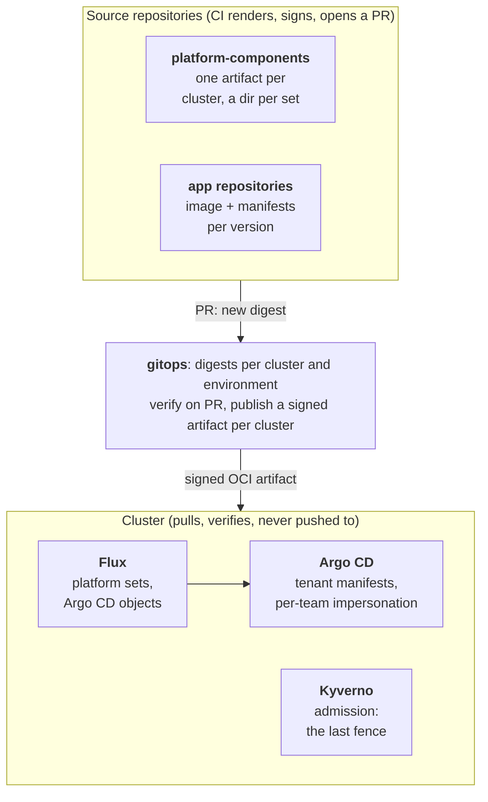

# GitOps architecture and its security decisions

How the cluster gets its state, who is trusted for what, and which fence stops what. The flows step
by step are in [platform-lifecycle.md](platform-lifecycle.md) and [app-lifecycle.md](app-lifecycle.md);
names and identities in [delivery.md](delivery.md); dated reasons in [decisions.md](decisions.md);
the principles in [security-baseline.md](security-baseline.md).

## The shape

- **Pull, never push.** No CI job holds cluster credentials; the cluster pulls signed artifacts from
  GHCR. The only way in from outside is the private access path and, for emergencies, break-glass.
- **Rendered, not templated, in the cluster.** Charts and `deploy.cue` are rendered in CI; what is
  reviewed in a PR diff is what the cluster applies. No Helm in the cluster except Kyverno (a
  documented exception).
- **OCI artifacts by digest, not git.** Neither Flux nor Argo CD reads a git repository. Every
  artifact is content-addressed and pinned by digest in `gitops`, which is the output lock: what
  runs where. Rollback is a revert there. ~~Rendered YAML committed to git~~,
  ~~render in `gitops` CI~~ ([decisions.md](decisions.md), 2026-11-07).

## Signatures: who signs what, who checks it

All signatures are cosign keyless (GitHub OIDC → Fulcio); there are no signing keys.

| Artifact                | Signed in                                                                   | Checked by                                                                                                                             |
| ----------------------- | --------------------------------------------------------------------------- | -------------------------------------------------------------------------------------------------------------------------------------- |
| app image and manifests | `github-workflows` `app-release.yaml` (preview: `app-preview.yaml`)         | gitops verify (identity, source repo and tag, signing commit on `github-workflows` main); Kyverno for every pod image, per environment |
| platform artifact       | `platform-components/.github/workflows/release.yaml@refs/heads/main` itself | Flux (`OCIRepository` verify)                                                                                                          |
| `gitops/<cluster>`      | `gitops/.github/workflows/publish.yaml@refs/heads/main` itself              | Flux                                                                                                                                   |

Two choices here are deliberate:

- **What Flux verifies is signed in the publishing repository's own job**, pinned to
  `refs/heads/main`. Flux matches only issuer and subject; a reusable workflow would make the
  subject `github-workflows` and let any branch of the caller produce an accepted artifact.
- **App artifacts are signed by the platform's reusable workflow**, so an app repository cannot
  sign something the platform accepts by itself. Callers pin that workflow by commit SHA, so the
  identity allows any ref; gitops verify closes the gap that opens (a fork's commit is reachable by
  SHA through the parent) by requiring the signing commit to be on `github-workflows` main.
  ~~Tags only~~: gives up SHA pinning.

## Flux: the platform

- **Flux Operator** installs Flux from a `FluxInstance`. The root `Kustomization` applies the
  `gitops` artifact as `gitops-root`, which may only create `OCIRepository` and `Kustomization`
  objects in `flux-system`.
- **One Kustomization and one ServiceAccount per component** (`component-<name>`), with RBAC
  derived from the component's declaration. A compromised or broken chart is contained to what its
  component may do, and the audit log names it. Cilium, Flux, Kyverno and the bootstrap RBAC run
  privileged, each with a written reason. ~~One cluster-admin Flux~~.
- **Cluster-scoped objects are whitelisted by exact name, three times:** the CI check of the
  render, the component's RBAC (by kind) and the admission policy `component-whitelist` (names and
  API groups, which RBAC `create` cannot restrict). `kustomization-service-accounts` stops a
  Kustomization from borrowing another component's ServiceAccount.
- **Sets** (`rbac` → `system` → `policy` → `platform` → `tenants`) order the rollout; the policies
  arrive before what they police.

## Argo CD: the tenants

- **Headless.** No API server, UI, Dex, notifications or config-management plugins; nothing to log
  into and no tokens to leak. Teams see their state through Kubernetes RBAC.
- **No git access**: sources are the apps' OCI manifests artifacts, by digest.
- **Impersonation.** Argo CD syncs every Application as the destination namespace's `deployer`
  ServiceAccount, whose Role covers only the kinds an app renders (no Secrets, no RBAC objects, no
  pods/exec). The controller itself reads a fixed list of kinds (no Secrets; `respectRBAC: strict`)
  and may impersonate only those ServiceAccounts.
- **AppProjects per team**, platform-owned in `argocd-system`: the team's source repositories, its
  two namespaces as destinations, nothing at cluster scope. The `default` project is locked.
- **Where Applications live.** Staging and prod Applications in the team's `argocd-<team>`
  namespace, where the team can read them and nothing else of Argo CD. Preview ApplicationSets and
  their Applications stay in `argocd-system`: an ApplicationSet's Applications always live in its
  own namespace, and ApplicationSets in more than one namespace make their controller watch Secrets
  cluster-wide ([decisions.md](decisions.md), 2026-11-14).
- **Previews** sync as `argocd-system:<team>-preview-deployer`, which RBAC alone would let act in
  every namespace; Kyverno (`preview-deployer-scope`) holds it to `<team>-pr-<n>` and to the labels
  a preview namespace may carry.

## Kyverno: admission is the fence

CUE schemas make the right thing easy; admission makes the wrong thing impossible. All policies are
CEL (`policies.kyverno.io/v1`), Enforce unless stated, rendered with the cluster and run over the
render in CI. The full list with one line each is at the top of
`platform-components/policies/policies.cue`; by purpose:

| Purpose              | Policies                                                                                                                                                                                                                   |
| -------------------- | -------------------------------------------------------------------------------------------------------------------------------------------------------------------------------------------------------------------------- |
| Supply chain         | `tenant-images-by-digest`, `tenant-image-signatures` (identity per environment), `restrict-image-registries`, `disallow-latest-tag`                                                                                        |
| Tenant boundaries    | `tenant-deny-shell-access`, `tenant-deny-sa-token-secrets`, `tenant-deny-cluster-scoped`, `tenant-namespace-labels`, `tenant-network-policies`, `tenant-http-routes`, `tenant-postgres-clusters`, `preview-deployer-scope` |
| Platform delivery    | `component-whitelist`, `component-namespaces`, `kustomization-service-accounts`, `helmrelease-service-accounts`, `secretobjects-only-in-system`                                                                            |
| Defaults and hygiene | `tenant-defaults` (default-deny, limits, quotas, `view` in previews), `require-requests-limits` (Audit), `cleanup-finished-pods`, `cleanup-preview-namespaces`, `disallow-default-namespace`, `restrict-service-exposure`  |

## Isolation of a tenant namespace

Pod Security `restricted`; default-deny ingress and egress (Cilium), each app opening only what its
`deploy.cue` declares, to the team's own namespaces, kube-dns, named FQDNs and, if declared, the API
server; quotas and limit ranges; images from the org's registry, signed for that environment and
pinned by digest; no exec, attach, port-forward or ephemeral containers; no ServiceAccount token
Secrets; host names only from the team's own names on its environment's Gateway; secrets as files
from OpenBao (Kubernetes auth per app and environment), never as Kubernetes Secrets.

## Bots and tokens

No personal access tokens and no stored Actions secrets. Cross-repository PRs and tag pushes use
octo-sts: a workflow's OIDC token is exchanged for a short-lived GitHub token under a trust policy
in the target repository, which pins the workflow, event, ref or environment. `GITHUB_TOKEN` is
read-only and cannot open or approve PRs (org setting). GitHub itself is code
(`platform-terraform`): rulesets, signed commits, environments, the Actions allowlist.

## Known gaps

Tracked in [decisions.md](decisions.md#open): ClusterRole contents of a component are pinned by name,
not inspected; no off-cluster API audit log yet; human identity for the API and web UIs (NetBird
private access) is being added; backups and DR.
