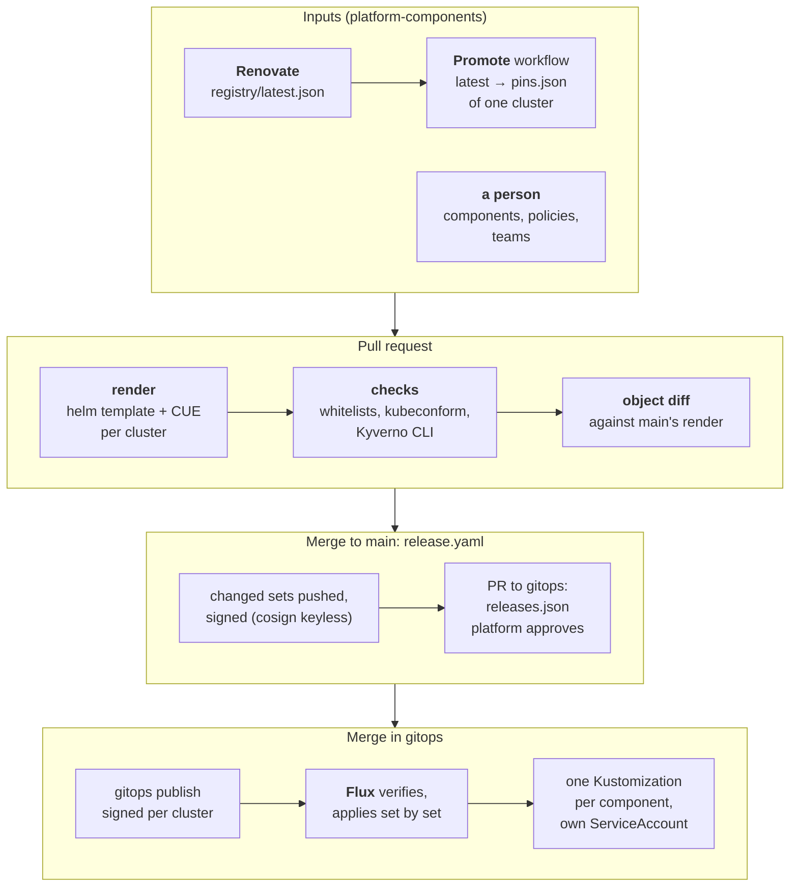

# Platform release lifecycle

How a change to the platform (a chart version, a component, a policy, a team) goes from a commit to
a cluster, how it is rolled back, and how the tooling around it is kept current. The contracts
between the repositories are in [delivery.md](delivery.md); why things are this way, in
[decisions.md](decisions.md).

## What a platform release is

`platform-components` describes every cluster in CUE: its components (a chart rendered with
`helm template` plus typed values, and/or plain objects), the Kyverno policies, and the teams. CI
renders a cluster into **sets**, applied in a fixed order, each published as **one signed OCI
artifact per cluster and set**:

| Set        | Contents                                                                                          |
| ---------- | ------------------------------------------------------------------------------------------------- |
| `rbac`     | namespaces and the per-component Flux ServiceAccounts with their RBAC                             |
| `system`   | Cilium, Flux Operator, Kyverno, cert-manager, OpenBao and the other operators                     |
| `policy`   | the Kyverno policies (`kyverno-policies`)                                                         |
| `platform` | Argo CD, Gateways, ClusterIssuers, the policies' ClusterRoles, everything that uses the operators |
| `tenants`  | one component per team: namespaces, quotas, deploy ServiceAccounts, AppProjects                   |

A set's artifact tag is a hash of its content, so an unchanged set is not pushed again and a
release only moves the digests of the sets that changed.

## From a commit to the cluster

1. **Inputs.** Renovate bumps chart versions and digests in `registry/latest.json` (field order
   there is a Renovate regex contract). Nothing reaches a cluster from there directly: the
   **Promote** workflow (`cue cmd promote -t to=<cluster>`) copies versions into that cluster's
   `pins.json` and opens a PR whose body lists every component's change, from → to. Other changes
   (a component, a policy, a team file) are ordinary PRs.
2. **Pull request checks** (`components-check.yaml` from `github-workflows`): render every
   cluster, check every cluster-scoped object against its component's whitelist, kubeconform, and
   run the rendered Kyverno policies over the render (once per component, as its Flux
   ServiceAccount, so admission rules on `request.userInfo` are exercised). A PR comment shows the
   object-level diff against the render of `main`, taken from that commit's CI artifact.
3. **Release** (`release.yaml`, push to `main`): render again, push the changed sets, sign them
   with cosign keyless in this workflow's own job, so the certificate subject is
   `platform-components/.github/workflows/release.yaml@refs/heads/main`. Then a PR to `gitops`
   moves `clusters/<cluster>/releases.json` (octo-sts identity `components-release`). The platform
   approves it; it never auto-merges.
4. **Delivery.** Merging in `gitops` publishes the cluster's artifact. Flux verifies its signature,
   then each set's `OCIRepository` signature, and applies the sets in order (`dependsOn`,
   `wait: true`). Inside a set every component is its own `Kustomization` with its own
   ServiceAccount (see [gitops-architecture.md](gitops-architecture.md)).
5. **Next cluster:** `promote -t from=<cluster> -t to=<next>`, the same path again.

## Rollback

Revert the release PR in `gitops`: the previous digests are still in GHCR and still signed. To
take a version back out of the inputs as well, revert the `pins.json` change in
`platform-components` (it releases again, with the old content and so the old set hash).

## Ordering traps (learned on alpha-01)

The sets are applied one after the other and Flux dry-runs every object of a component before
creating any. Some changes need a second step or a particular split:

- **A new ClusterRole name.** RBAC verbs `escalate`/`bind` are granted by exact name, and
  `component-whitelist` in the cluster knows only the names of the release already running. The
  policies' ClusterRoles therefore ship in `kyverno-policies-rbac` (set `platform`), one set after
  the policies that whitelist them.
- **A RoleBinding to a Role of the same component** needs `bind` on that Role's name: without it
  the API server looks the Role up during Flux's dry-run, before it exists, and answers "not found".
- **A new GeneratingPolicy with `generateExisting`** runs once when it arrives, before its
  ClusterRole (set `platform`), and does not retry; only new triggers generate.
- **Policy status** (`RBACPermissionsGranted`) is recomputed only when the policy changes or the
  Kyverno admission controller restarts.
- **Renaming a component's namespace:** clear the Kustomization's inventory once (CLAUDE.md of
  `platform-components` has the command); never delete the Kustomization.

## Variants of a component

- **Rendered** (the default): the chart is rendered in CI; the cluster only ever sees plain
  objects. Hooks are kept or dropped by an explicit policy in the render script.
- **HelmRelease** (needs a reason, today only Kyverno): Flux runs the chart in the cluster, from
  the same OCI chart by digest. CI still renders it approximately (`out/<cluster>/.approx`) so the
  whitelist check, Kyverno and the PR diff cover it. Post-renderers patch what the chart does not
  expose (e.g. a TTL on Kyverno's migration Job).

## The tooling around it

| What                                       | How it is updated                                                                                                                                                                          |
| ------------------------------------------ | ------------------------------------------------------------------------------------------------------------------------------------------------------------------------------------------ |
| Charts                                     | Renovate → `registry/latest.json` → Promote, as above                                                                                                                                      |
| Reusable workflows                         | `github-workflows` releases with release-please; callers pin a commit SHA (Renovate, group `github-workflows`); gitops verify requires the signing commit to be on `github-workflows` main |
| `platform-kit` (CUE module, devenv module) | tags `v*`, Renovate bumps the consumers                                                                                                                                                    |
| `devenv.lock`                              | weekly `devenv update` PR (Monday 06:00 UTC) in every repository, auto-merged once CI passes                                                                                               |
| GitHub org, OpenBao                        | `platform-terraform`, `tofu plan`/`apply` by the owner                                                                                                                                     |
| Renovate rules                             | the org preset in `.github` (`default.json`)                                                                                                                                               |

## Bootstrap and break-glass

A new cluster starts by hand over the break-glass path: Talos, then `cue cmd bootstrap` (Cilium,
Flux Operator, the `gitops` source and root Kustomization), then OpenBao's seal key. From there
Flux takes over. Steps: [delivery.md](delivery.md#bootstrap-once-per-cluster-by-hand-over-the-break-glass-path)
and `platform-components/docs/bootstrap.md`.
